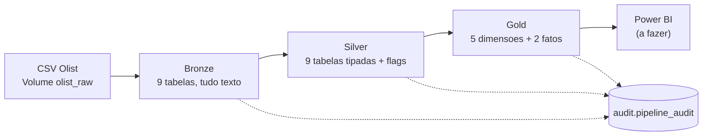

# olist-databricks-pipeline

Pipeline de engenharia de dados (arquitetura medalhão: Bronze, Silver e Gold) construído no **Databricks Free Edition** com **Spark SQL e Python**, usando o dataset público de e-commerce da Olist. O projeto tem validações em cada camada, tabela de auditoria, um Job com dependências entre tarefas e execução agendada.

> **Status:** Bronze, Silver, Gold, Job e agendamento concluídos e testados. Dashboard em Power BI: **ainda não construído**. Este README só afirma o que foi executado e conferido; o que não foi testado aparece em [Limitações](#limitações-conhecidas) e em [docs/testes_e_evidencias.md](docs/testes_e_evidencias.md).

## Problema de negócio (cenário fictício)

A diretora comercial de um marketplace fictício precisa de um painel semanal e confiável com **vendas, atrasos de entrega e clientes insatisfeitos**. O relatório anterior "mudava de número de um dia para o outro", então o requisito central é **confiança**: números reproduzíveis, reconciliados com a origem e com regras de negócio escritas.

O cenário é uma simulação para fins de portfólio. Os dados são reais; o pedido do cliente não é.

**Perguntas que o projeto responde**

1. Qual a receita por mês e por categoria?
2. Quais estados e vendedores mais vendem?
3. Qual o percentual de pedidos entregues depois do prazo prometido?
4. Quantos dias, em média, passam da compra à entrega?
5. Pedidos atrasados recebem notas piores?
6. (extra) Pedidos com vendedor e cliente mais distantes atrasam mais?

## Dados e licença

- **Fonte:** *Brazilian E-Commerce Public Dataset by Olist* (Kaggle), 9 arquivos CSV, pedidos de 2016-09 a 2018-10.
- **Licença:** **CC BY-NC-SA 4.0** (conferida na página do dataset no Kaggle em out/2026). Uso não comercial, com atribuição e compartilhamento pela mesma licença.
- **Os CSVs não estão neste repositório** (ver `.gitignore`). Baixe-os da fonte oficial.
- Os dados são anonimizados. Este projeto não os apresenta como dados de uma empresa real.

## Arquitetura



| Camada | O que faz | Regra principal |
|---|---|---|
| **Bronze** | Carrega os CSVs como vieram, **tudo como texto**, com `_arquivo_origem` e `_data_ingestao` | Não corrigir nada na entrada. Tipar cedo destruiria informação (ex.: CEPs com zero à esquerda) |
| **Silver** | Tipa, padroniza e **sinaliza** problemas com colunas `flag_*` | **Preservar e sinalizar** em vez de apagar. Cada exclusão é decisão de negócio, tomada na Gold |
| **Gold** | Modelo dimensional (Star Schema) com a regra de negócio escrita uma vez | Agregar antes de juntar, para evitar duplicação de linhas em JOINs |

Todas as tabelas de cada camada são descritas em **dicionários Python** (SQL, chave, regras de qualidade, reconciliações) e executadas por uma única rotina por camada: `process_bronze()`, `process_silver()` e `process_gold()`.

## Modelo dimensional

Duas tabelas fato, porque as medidas têm granularidades diferentes:

| Tabela | 1 linha = | Responde às perguntas |
|---|---|---|
| `fact_itens_pedido` | um item de um pedido | 1 e 2 (receita, categoria, vendedor) |
| `fact_pedidos` | um pedido | 3, 4, 5 e 6 (atraso, prazo, nota, distância) |
| `dim_calendario`, `dim_cliente`, `dim_vendedor`, `dim_produto`, `dim_cep` | uma data, cliente, vendedor, produto ou CEP | Todas |

Escolhas de modelagem: **Star** (a tradução da categoria foi incorporada em `dim_produto`, sem Snowflake) e **chaves naturais** (não há histórico que justifique chaves substitutas). Dicionário completo em [docs/dicionario_de_dados.md](docs/dicionario_de_dados.md).

## Qualidade de dados e testes

Cada camada valida o que gravou, e **qualquer divergência interrompe o pipeline**:

- **Bronze:** contagem igual à da origem, tabela por tabela.
- **Silver:** contagem igual à Bronze, chave única, colunas obrigatórias, **vazios iguais antes e depois das conversões de tipo** (uma conversão que falha vira vazio sem avisar) e regras de domínio.
- **Gold:** chave única, integridade referencial com as dimensões e **reconciliação financeira** entre as tabelas.

Regras detalhadas em [docs/regras_de_qualidade.md](docs/regras_de_qualidade.md). A tabela `workspace.audit.pipeline_audit` registra cada execução (identificador, camada, tabela, início, fim, duração, status, linhas esperadas e gravadas, mensagem de erro) e só acumula (`append`).

## Automação

O Job `olist_pipeline` tem três tarefas em fila: `bronze` → `silver` → `gold`, cada uma executando o notebook `run_*` da camada. Se uma tarefa falhar, as seguintes **não rodam**. Retentativas automáticas foram **desligadas**, porque os erros esperados são de qualidade e repetir não os resolve. Uma execução **agendada** foi testada (coluna *Launched* = "By scheduler").

## Resultados comprovados

Tudo abaixo foi executado no Databricks Free Edition. Detalhes e perguntas de cada teste em [docs/testes_e_evidencias.md](docs/testes_e_evidencias.md).

**Reconciliação financeira**

| Medida | Origem / Silver | Gold |
|---|---|---|
| Soma de `payment_value` | R$ 16.008.872,12 | R$ 16.008.872,12 |
| Soma de `price` (itens) | R$ 13.591.643,70 | R$ 13.591.643,70 |
| Soma de `freight_value` | R$ 2.251.909,54 | (reconciliada na Silver) |
| Receita (exclui `canceled` e `unavailable`) | | R$ 13.494.400,74 (exclui R$ 97.242,96 em 549 itens) |

**Repetibilidade e falhas**

- 2 execuções do Job com os mesmos dados: contagens e receita idênticas (99.441 pedidos e R$ 13.494.400,74).
- Falhas provocadas e detectadas: Bronze (contagem), Silver (vazios e regra de CEP), Gold (reconciliação entre fatos) e Job (falha na Silver, **Gold não executou**, recuperação com nova execução).
- Execução agendada concluída com sucesso, com 9/9 (Bronze), 9/9 (Silver) e 7/7 (Gold) tabelas `OK`.

**Respostas de negócio** (conforme as regras provisórias de [docs/perguntas_ao_cliente.md](docs/perguntas_ao_cliente.md))

| Pergunta | Resultado |
|---|---|
| Receita total | R$ 13.494.400,74 (maior mês: 2017-11, R$ 1.003.862,14) |
| 3. Pedidos entregues após o prazo (comparando a data) | 6.534 de 96.470 = **6,77%** (4.664 com mais de 3 dias = 4,83%) |
| 4. Dias da compra à entrega | média de **12,5** |
| 5. Nota média: no prazo x atrasados | **4,29** x **2,27** (associação observada, não causa) |
| 6. Atraso por distância | de **4,48%** (até 100 km) a **11,60%** (1.500 km ou mais), crescendo a cada faixa |

Os meses de 2016 e o fim de 2018 têm poucos pedidos (set/2018: 1). Isso reflete o recorte da base e **não deve ser lido como tendência**.

**Tempo de execução observado** (poucas medições, sem conclusão estatística): Job completo entre 3 min 56 s e 5 min 22 s. Por camada, somando as tabelas na auditoria: Bronze 30 a 46 s, Silver 98 a 115 s, Gold 68 a 78 s.

## Limitações conhecidas

- **A validação roda depois de gravar.** Ela bloqueia as tarefas seguintes e protege a Gold, mas não desfaz a gravação da camada que falhou.
- **Carga completa** (`overwrite`) a cada execução. Não há processamento incremental. Para este volume é simples e seguro (idempotente).
- A auditoria do projeto registra apenas o que **executou**. Uma tarefa bloqueada não gera linha, e isso só aparece no histórico do Databricks.
- **Não testado ainda:** entradas defeituosas reais (novos registros, duplicidades e valores inválidos nos arquivos), reexecução parcial do Job (só das tarefas que falharam) e o dashboard.
- `geolocation` não tem chave natural (26% de linhas duplicadas); é tratada por contagem e regras.
- A distância é **estimada** (mediana das coordenadas do prefixo de CEP, fórmula de Haversine). Para pedidos com mais de um vendedor, usa-se a maior distância (**suposição**).
- Várias regras de negócio (receita, atraso, nota por pedido, período de análise) são **propostas pendentes de confirmação**, listadas em [docs/perguntas_ao_cliente.md](docs/perguntas_ao_cliente.md).
- O Free Edition tem cota de computação e só oferece computação serverless; a execução agendada não tem garantia de disponibilidade.
- O Job ainda aponta para os notebooks do Workspace, e não para este repositório.

## Como reproduzir

1. Crie uma conta no **Databricks Free Edition**.
2. Baixe os 9 CSVs do dataset Olist no Kaggle.
3. No Databricks, crie um volume `olist_raw` em `workspace.default` e envie os 9 arquivos (o caminho esperado é `/Volumes/workspace/default/olist_raw/`, definido em `notebooks/utils/config`).
4. Crie um **Git folder** apontando para este repositório.
5. Execute, em ordem, com *Run all*: `notebooks/01_bronze/run_bronze`, `notebooks/02_silver/run_silver` e `notebooks/03_gold/run_gold`. Cada um termina com "validada" ou levanta erro.
6. (Opcional) Crie um Job com três tarefas em fila, uma para cada notebook `run_*`, e retentativas desligadas.

Os notebooks estão em formato `.ipynb` e carregam as funções com `%run` relativo (`../utils/...`), então a estrutura de pastas deve ser mantida.

## Estrutura do repositório

```
notebooks/
  01_bronze/run_bronze        executa e valida a Bronze
  02_silver/run_silver        executa e valida a Silver
  03_gold/run_gold            executa e valida a Gold
  utils/
    config                    caminhos, tabelas e contagens esperadas
    funcoes_audit             tabela de auditoria
    funcoes_bronze            process_bronze()
    funcoes_silver            dicionário de tabelas + process_silver()
    funcoes_gold              dicionário de tabelas + process_gold()
sql/                          consultas de investigação, validação e negócio
docs/                         decisões, perguntas ao cliente, dicionário, regras, testes
```

## Próximos passos

- Dashboard em **Power BI** (modelo semântico, medidas em DAX e uma página de qualidade de dados).
- Testes com **entradas defeituosas reais** e idempotência com dados novos.
- Fazer o Job ler os notebooks deste repositório.
- Confirmar com o cliente as regras pendentes e revisar a documentação.

## Créditos

Dados: Olist, *Brazilian E-Commerce Public Dataset by Olist* (Kaggle), licença CC BY-NC-SA 4.0. Este projeto transforma os dados e não os redistribui.
